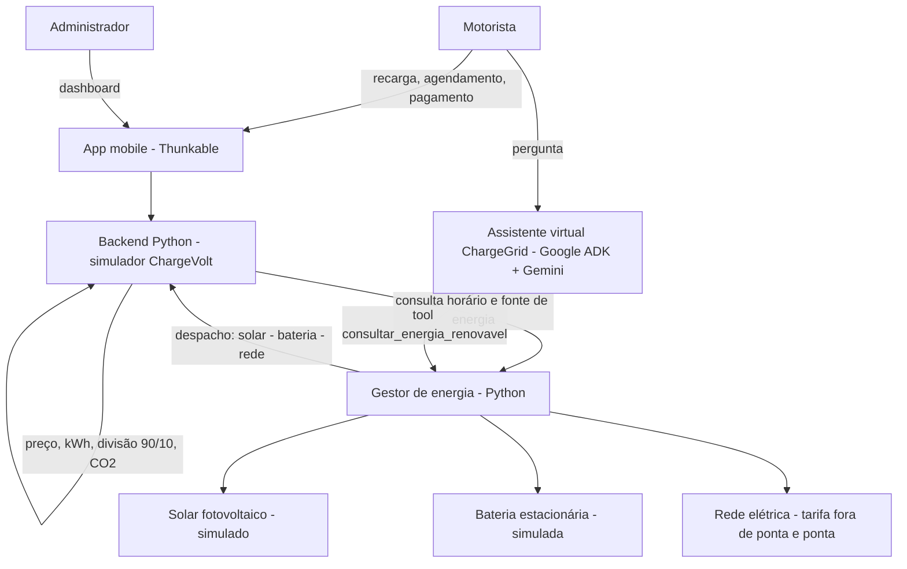

# ChargeVolt — Eletroposto inteligente com energia solar, bateria e assistente virtual

**Challenge GoodWe 2026 · Turma 1CCPY · Soluções em Energias Renováveis e Sustentáveis (SERS)**

## Equipe

| Nome | RM |
|---|---|
| Gabriela Caetano | 572738 |
| Laura Pícari | 569914 |
| Lucas Neves | 572679 |
| João Victor | 571630 |
| Beatriz Araújo | 570619 |

Vídeo técnico (YouTube, não listado): _link na entrega_ · Repositório: este.

> **Transparência sobre os dados.** O ChargeVolt é um **protótipo de simulação**: não há inversor, bateria ou carregador físicos conectados. Todo resultado de energia, custo e CO₂ abaixo vem de uma **simulação com hipóteses explícitas** (seção 5) e **não são medições**. O que é código real e funcional está marcado como *implementado*.

## 1. O problema

Muitos eletropostos comerciais não têm mecanismos inteligentes para gerenciar sessões de recarga, controlar o consumo e automatizar cobrança. Com a mobilidade elétrica crescendo, isso gera desperdício de energia, sobrecarga da rede (principalmente no horário de ponta) e pouca flexibilidade para o usuário. Nossa proposta liga o eletroposto à **geração solar e ao armazenamento em bateria** e usa **agendamento inteligente** para que a recarga aconteça quando a energia é mais limpa e mais barata.

### 1.1 Evolução do projeto (Sprints 1 a 3)

| Sprint | O que foi entregue | Repositório | Vídeo |
|---|---|---|---|
| **1 — Proposta** | Definição do problema e da solução: uso **com ou sem cadastro**, carteira digital e programa de fidelidade por pontos; código inicial das disciplinas do semestre | [FIAP_GoodWe_2026](https://github.com/lusnowky/FIAP_GoodWe_2026) | [pitch](https://youtu.be/mFJE4k8r_vk) |
| **2 — Prova de conceito** | Protótipo em Python (terminal): cadastro, carteira, recarga com cobrança por tarifa normal ou de pico (18h–22h), pontos de fidelidade, simulador de consumo e autonomia, histórico e CO₂ evitado | [SPRINT2_ENERGIAS_RENOVAVEIS_E_SUSTENTAVEIS](https://github.com/Gabrielathw/SPRINT2_ENERGIAS_RENOVAVEIS_E_SUSTENTAVEIS) | [pitch](https://youtu.be/kr2H-bHmqO8) |
| **3 — App e backend** | App mobile (Thunkable) + backend Python com agendamento, divisão de receita 90/10, dashboard admin e sensor simulado | [SPRINT-3_-SERS](https://github.com/Gabrielathw/SPRINT-3_-SERS) | [pitch](https://youtu.be/aBJwic4X-5A) |
| **Final — Energia renovável** | Gestor de energia solar + bateria, agendamento inteligente, integração e assistente virtual (este repositório) | este | _link na entrega_ |

> As tarifas mudaram ao longo das sprints: nas Sprints 1 e 2 e nos códigos de outras disciplinas usou-se R$ 1,97/kWh mais R$ 0,89 por sessão (pico a R$ 2,25); o backend da Sprint 3 usa R$ 0,90/kWh. A simulação final usa o valor do backend da Sprint 3.

## 2. Arquitetura final



| Camada | O que faz | Estado |
|---|---|---|
| **App mobile** (`app/`) | Interface do motorista e do admin: cadastro, estação, pagamento, agendamento, histórico, dashboard | *Implementado* (Thunkable, modo simulação) |
| **Backend** (`backend/`) | Regras de negócio: R$ 0,90/kWh, carregador de 7,4 kW, pontos de fidelidade, divisão de receita 90% estabelecimento / 10% GoodWe, CO₂ evitado, sensor simulado, dashboard admin | *Implementado* (Python) |
| **Gestor de energia** (`energia/`) | Simula 24 h de solar + bateria + rede, com **despacho inteligente** e **recomendação de horário** | *Implementado* (Python, dados simulados) |
| **Integração** (`integracao/`) | Liga o fluxo de recarga do backend ao gestor de energia, sem alterar o backend | *Implementado como demonstração em Python*; **ainda não está dentro do app Thunkable** |
| **Assistente virtual** (`chatbot/`) | Agente ChargeGrid (Google ADK + Gemini) com 3 tools de potência, ciclos e faturamento; avaliado de forma automática na Sprint 4. A tool `consultar_energia_renovavel` liga o agente ao gestor | Agente *implementado*; **a tool nova ainda não foi testada dentro do agente** |

### Algoritmo de despacho de energia (o diferencial inteligente)

A cada hora, o gestor decide de onde vem a energia (`energia/gestor_energia.py`):

1. **Solar primeiro:** a geração fotovoltaica atende a recarga em andamento.
2. **Sobra solar vai para a bateria** (com perdas: eficiência ida-e-volta de 90%).
3. **Bateria cobre a ponta (18h–21h):** é quando a energia da rede é mais cara e a rede está mais carregada.
4. **Carga da rede no vale (madrugada):** com a **previsão do dia**, o gestor calcula quanto falta para cobrir a ponta e carrega só esse valor da rede, a 8 kW. Assim a bateria é útil mesmo em dia nublado.
5. **Agendamento inteligente:** usando o agendamento que o app já tem, o cenário D **supõe** que 30% da demanda de ponta é flexível e a desloca para a janela solar (10h–16h) (hipótese da simulação). A função `melhor_horario()` recomenda a hora com maior cobertura solar, fora da ponta.

O gestor também rastreia a **origem da energia na bateria** (solar × rede), para só contar como renovável a parcela que de fato veio do sol.

## 3. Alinhamento ao desafio GoodWe e à disciplina

- **Desafio GoodWe:** integrar o eletroposto a geração, armazenamento e uso de energia renovável com monitoramento inteligente. O gestor modela exatamente essa cadeia (solar → bateria → carga → rede) e o backend mantém a divisão de receita com a GoodWe.
- **Tecnologias compatíveis GoodWe:** o modelo representa um sistema fotovoltaico com **inversor e bateria** e usa a rede de eletropostos como carga. Em produção, a leitura da geração e do estado da bateria viria do inversor (o desafio cita os protocolos **MODBUS** para medição e **OCPP** para os carregadores). **Neste protótipo esses protocolos não estão implementados**: a geração é uma curva simulada e a integração real é trabalho futuro.
- **Disciplina (energias renováveis e sustentabilidade):** geração fotovoltaica, armazenamento, deslocamento de carga (*demand shifting*), horário de ponta e cálculo de CO₂ evitado estão na lógica do sistema, não só na descrição.
- **Outras disciplinas do curso:** Python e estruturas de dados (backend e gestor), Prompt and Artificial Intelligence (assistente virtual e sua avaliação), Computer Organization and Architecture (sensor e hardware simulados) e Modelagem Linear para ML (análise de dados). O trabalho dessas disciplinas está no repositório [FIAP_GoodWe_2026](https://github.com/lusnowky/FIAP_GoodWe_2026) e se conecta assim:

| Disciplina | O que a equipe desenvolveu (no repositório citado) | Conexão com a solução de energia |
|---|---|---|
| Data Structures and Algorithms | App web em Flask com sessões de recarga, ordenação (*bubble sort*), busca sequencial, histórico e **tarifação dinâmica** (adicional de R$ 0,30 quando há mais de 3 carros ou mais de 80 kWh na sessão) | Mesma ideia de preço que reage à demanda; no gestor de energia o preço de compra varia com a ponta |
| Computer Organization and Architecture | Estação em MicroPython para **Raspberry Pi Pico** (diagrama Wokwi com LEDs verde, amarelo e vermelho e display LCD 16×2) com **balanceamento dinâmico de potência**: se a demanda passa da energia disponível, reduz cada carregador proporcionalmente (`potenciaMax / demandaTotal`) e sinaliza o estado nos LEDs e no LCD | É o equivalente em hardware simulado do controle de pico: limita a potência para proteger a infraestrutura |
| Modelagem Linear para ML | Análise de frequência de uma base de dados (tempo de espera e preço da eletricidade) com *pandas* | Justifica a automação do carregamento e a tarifação por demanda |

  O balanceamento do Pico e o gestor de energia resolvem o mesmo problema (pico de demanda) em camadas diferentes; **eles ainda não estão integrados** em um único fluxo.

## 4. Diferenciais inovadores

| Diferencial | Onde está | Estado |
|---|---|---|
| Despacho inteligente solar → bateria → rede com previsão do dia | `energia/gestor_energia.py` | Implementado (simulado) |
| Agendamento que recomenda o melhor horário de recarga | `melhor_horario()` + agendamento do app | Implementado (simulado) |
| Rastreio da origem renovável da energia da bateria | `gestor_energia.py` | Implementado |
| Visualização de dados (fluxo horário, comparação, sensibilidade) | `energia/resultados/*.png` | Implementado |
| Assistente virtual com ferramentas e avaliação automática (LLM como juiz) | `chatbot/` e notebook da Sprint 4 | Implementado |
| App com interface amigável, histórico e dashboard | `app/` | Implementado (Thunkable) |

## 5. Resultados da simulação (dados simulados)

**Como foi feito:** 24 h simuladas, hora a hora, em 4 cenários: **A** só rede, **B** solar direto, **C** solar + bateria, **D** solar + bateria + agendamento. Rode `python energia/simular_dia.py` para reproduzir; os dados completos estão em `energia/resultados/resultados_cenarios.csv`.

**Hipóteses (todas ajustáveis em `Config`):** sistema fotovoltaico de 30 kWp (desempenho 80%); bateria de 40 kWh úteis, 20 kW, eficiência 90%, reserva 10%; posto com 4 carregadores de 7,4 kW vendendo 240 kWh/dia; preço ao motorista R$ 0,90/kWh (valor do backend); energia comprada da rede a R$ 0,70/kWh fora da ponta e R$ 1,40/kWh na ponta (**valores hipotéticos**); excedente solar sem compensação; fator de CO₂ de 0,12 kg/kWh (valor usado no backend; **deve ser conferido com o fator oficial da rede brasileira**, e os resultados de CO₂ mudam proporcionalmente).

### Dia parcialmente nublado

| Cenário | Energia da rede (kWh) | Cobertura solar da recarga | Pico na ponta (kW) | Custo da energia (R$/dia) | Margem (R$/dia) | CO₂ evitado (kg/dia) |
|---|---|---|---|---|---|---|
| **A** Só rede (sem solar) | 240 | 0% | 19,1 | 201 | 15 | 0,0 |
| **B** Solar direto | 156 | 35% | 19,1 | 142 | 74 | 10,1 |
| **C** Solar + bateria | 160 | 35% | 12,0 | 121 | 95 | 9,7 |
| **D** Solar + bateria + agendamento | 159 | 35% | 0,0 | 112 | 104 | 9,7 |


### Sensibilidade ao tipo de dia (cenário D)

| Tipo de dia | Solar gerado (kWh/dia) | Cobertura solar (D) | Custo A → D (R$/dia) | Economia (R$/dia) | CO₂ evitado (kg/dia) |
|---|---|---|---|---|---|
| ensolarado | 168 | 69% | 201 → 53 | 149 | 19,7 |
| parcial | 84 | 35% | 201 → 112 | 90 | 9,7 |
| nublado | 46 | 19% | 201 → 139 | 63 | 5,0 |


### Leitura dos resultados

- **Solar:** no dia parcialmente nublado a recarga é atendida com 35% de energia solar (B). No dia ensolarado chega a 69%; no nublado cai para 19%.
- **Bateria e agendamento:** quase não mudam a energia comprada da rede, mas **deslocam a compra para fora da ponta**: o pico de demanda na ponta cai de 19,1 kW (A) para 0,0 kW (D) e o custo da energia, de R$ 201 para R$ 112 por dia.
- **Margem:** com as tarifas hipotéticas, vender a R$ 0,90 comprando energia a R$ 1,40 na ponta dá prejuízo naquelas horas; a margem diária sobe de R$ 15 (A) para R$ 104 (D).
- **CO₂:** 9,7 kg/dia evitados no dia parcial (D). Extrapolando de forma **ilustrativa e linear** para 365 dias iguais, seriam cerca de 3,5 t/ano e R$ 32.796 de economia na energia comprada (sem considerar o investimento).

### Resultados qualitativos

- O motorista recebe uma recomendação clara de horário (ex.: recarregar 30 kWh às 13h, com cobertura solar estimada de 57%) e evita a ponta, o que também alivia a rede.
- O administrador enxerga, no mesmo painel, receita, divisão 90/10, energia por origem e CO₂ evitado.
- O assistente virtual responde dúvidas do usuário e consulta o gestor de energia por uma ferramenta.

### Avaliação do assistente virtual (Sprint 4)

_Inserir aqui a tabela por versão (V1 Sprint 2 × V2 Sprint 3) gerada pelo notebook de avaliação, com a nota final de cada versão e a conclusão._

## 6. Avaliação crítica

**Benefícios de sustentabilidade e inovação**
- Mais energia solar usada na própria recarga e menos compra na ponta, reduzindo emissões e a pressão sobre a rede.
- A decisão é **explicável**: regras claras (solar primeiro, bateria na ponta, carga no vale), fáceis de auditar e de ajustar.

**Limitações e riscos (importante)**
- **Tudo é simulação.** Geração, demanda, bateria e tarifas são hipóteses; não há dados medidos nem hardware GoodWe conectado.
- **O benefício da bateria depende do cenário.** Em dia nublado ela **não aumenta a energia solar usada**; o ganho vem da *arbitragem de tarifa* (comprar barato no vale, usar na ponta). Como há perdas de ~10%, o CO₂ evitado em C e D fica **um pouco abaixo** do cenário B no dia parcial e no nublado.
- **Viabilidade econômica não calculada:** os valores acima não incluem o custo de painéis, bateria, instalação e manutenção.
- **Previsão perfeita:** o despacho usa a previsão do dia como se fosse exata; na prática haveria erro de previsão.
- O fator de CO₂ (0,12 kg/kWh) vem do backend e precisa ser validado com fonte oficial.
- Segurança do protótipo: o backend e o app usam contas de teste e senhas em texto no código (por exemplo `ADMIN`/`demo` e um admin fixo no app), aceitável só em simulação; em produção seria preciso autenticação real e senhas com hash.

**Próximos passos:** ler dados reais do inversor por MODBUS, controlar carregadores por OCPP, usar previsão meteorológica, e calcular retorno do investimento.

## 7. Como executar

```bash
# Backend do ChargeVolt (menu interativo; login de teste: demo / 123456, admin: ADMIN / admin123)
python backend/chargevolt_simulador.py

# Simulação de energia (gera gráficos e CSV em energia/resultados). Requer: pip install matplotlib
python energia/simular_dia.py

# Demonstração integrada: pedido de recarga -> recomendação de horário -> cobrança -> painel
python integracao/demo_integrado.py
```

O app mobile (`app/chargevolt_app_thunkable.js`) é o código exportado do Thunkable.

## 8. Estrutura do repositório

```
app/            código do app mobile (Thunkable)
backend/        simulador Python do ChargeVolt
energia/        gestor de energia solar + bateria, simulação e resultados (gráficos, CSV, JSON)
integracao/     demonstração integrada backend + gestor de energia
chatbot/        ferramenta que liga o assistente virtual ao gestor de energia
docs/           referências e explicações técnicas
```

## 9. Referências e ferramentas

- **Linguagens e frameworks:** Python (biblioteca padrão; matplotlib para gráficos), Thunkable (app), Google ADK e Gemini (assistente virtual), Mermaid (diagramas).
- **Conceitos:** geração fotovoltaica, armazenamento em bateria, *peak shaving* e deslocamento de carga, tarifação por horário, protocolos OCPP e MODBUS (referência para a integração real).
- **Ferramentas de IA como apoio:** DeepSeek e Claude, para técnicas ainda não dominadas pela equipe e revisão de partes do código (ver `docs/REFERENCIAS.md`).
- Detalhes e explicações do código: `docs/REFERENCIAS.md`.
